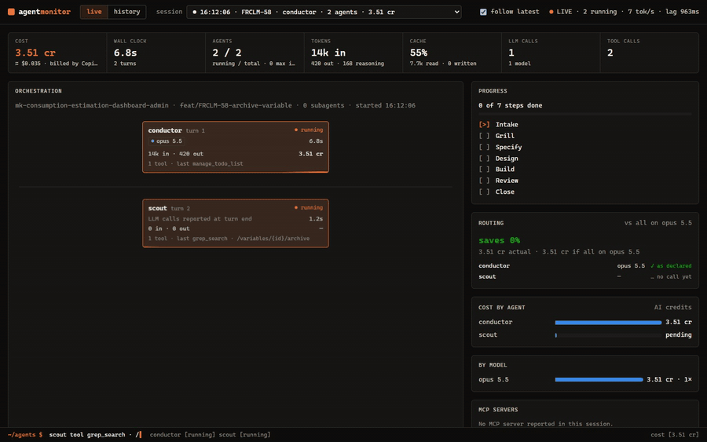
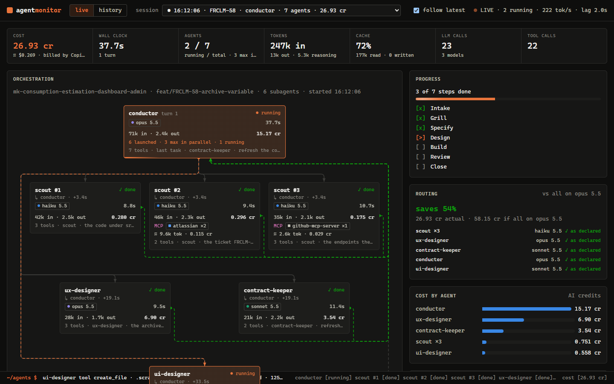
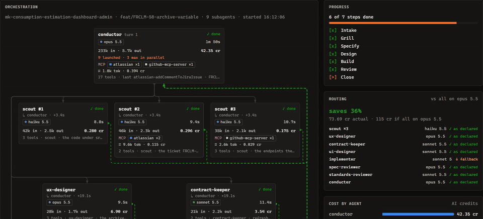
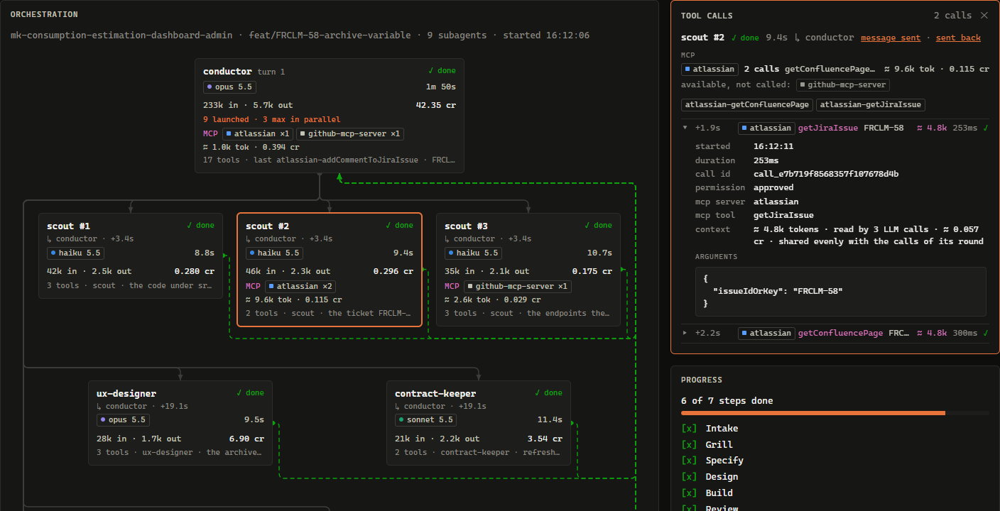
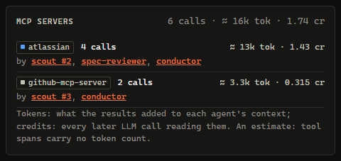
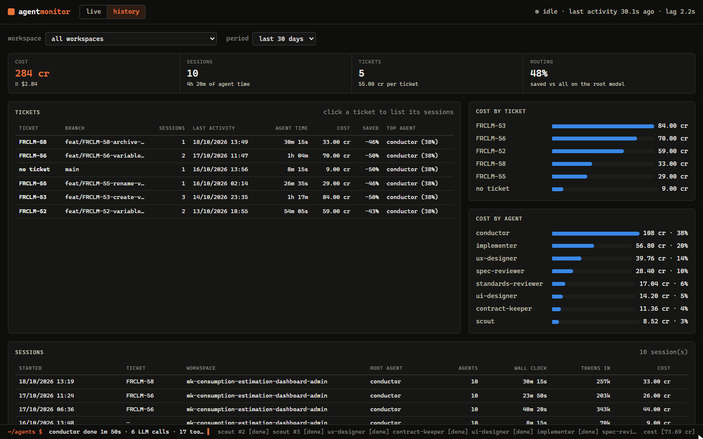

# agent-monitor

A live view of GitHub Copilot agents and subagents in VS Code: who delegated to whom, which
agents are working right now, what each one calls, the tokens and the cost, turn by turn.

It works for every workspace at once. One local process receives what VS Code reports and
serves the page; nothing leaves the machine.



```bash
npm start          # or: pnpm start
```

Then open <http://localhost:4319>.

## Set up VS Code once

Add to your VS Code **user** settings:

```jsonc
"github.copilot.chat.otel.enabled": true,       // the chat extension's harness
"chat.agentHost.otel.enabled": true,            // the agent host (Copilot harness), VS Code's default since 1.14x
"chat.agentHost.otel.otlpProtocol": "http/json"
```

Then **quit VS Code completely and reopen it**: the agent host reads these settings when it
starts, not when they change. A window reload is not enough.

The monitor listens on `localhost:4318`, the endpoint Copilot exports to by default, so no
endpoint needs setting. It listens on both `127.0.0.1` and `::1`, because `localhost` resolves to
IPv6 first on Windows.

Optional: without more, the page shows what each agent did but not what it was asked or what it
read. The note *Arguments and results show here with hooks, or with
chat.agentHost.otel.captureContent: true* says so. [What spans leave
out](#what-spans-leave-out) lists what is missing and how to turn it on: content capture
(`"chat.agentHost.otel.captureContent": true`) or `npm run install-hooks`.

## What the page shows



**Live**, one session at a time:

- **Totals**: cost in AI credits and dollars, wall clock, agents running, tokens in and out,
  cache hit rate, LLM and tool calls.
- **Orchestration**: the workspace, branch and ticket, then a tree, top to bottom: the root agent
  of each turn on top, the agents it launched in rows below it, and the agents those launched in
  turn below them. Every card says who launched it and how far into that agent's run
  (`↳ conductor · +20.3s`), with its status (running, done, stalled, failed), model, duration,
  tokens, cost and last tool call. Agents that ran side by side share a row; the next wave, which
  started once the previous one had finished, opens a new one. Click a card to list its tool calls
  beside the tree and to filter the log and the timeline to that agent.

  Two lines join an agent to the one that launched it, and each has one direction:
  - **Out**, a solid line from the launcher's bottom-left, down the left side and along the bus
    above the agent's row, ending in an arrowhead on the agent's card. While the agent works,
    orange dashes advance along it, toward the agent.
  - **Back**, a dashed line from the right edge of the agent's card, down beside it, along a bus
    below its row and up the right side, ending in an arrowhead in the launcher's bottom-right.
    Faint until the agent is done, then green, with the dashes advancing for a few seconds; red if
    the agent failed.

  Lines run out on the left and back on the right, so none crosses a card or the other direction.
  Click a line to read its messages.

  **A run that resumes a turn.** Subagents run in the background: the agent host holds the turn
  until they finish, ends it, and starts the agent again at once to read their answers with
  `read_agent`. That second run is not a new message from you. It is tagged `↻ resumes turn 1`,
  keeps the turn's number, is not counted as a turn, and sits under the first run with no divider.
  The lines back from the subagents it read run on down the right side into the top of its card,
  where the answers were read; a subagent read inside the run that launched it still comes back
  to that run. Spans do not say which subagent a `read_agent` call read (short of content capture
  or hooks), so it counts as having read every subagent that had finished when the call ended.
  A run counts as a resume when it starts within 5 seconds of the previous run's end, that run
  launched subagents, and it calls `read_agent`; any other run of the agent is the next turn.
- **Messages**, for the line you click. On a line out, what the launcher sent (the description,
  the full prompt, the agent type); on a line back, what came back once the agent was done. The
  agents a launcher started share the stretch out of its foot: a click there lists the message of
  every agent the line leads to, a click on the branch into one card that agent's only. Pointing
  at a line lights up every agent's line that runs there. `sent` and `sent back` switch direction;
  the names lead to each agent's tool calls. The tool calls panel links to an agent's messages too.

  
- **Tool calls**, for the agent you click: how many of each tool, then every call in order, with
  when it started into the agent's run, how long it took and how it ended. Open a call for its
  call id, permission, skill, process and exit code, the agent a `task` call launched (click it to
  move to that agent), and its arguments and result when hooks or content capture report them.
  Above the calls, the agent's MCP use: each server it called, how often, which tools, what the
  results cost, and the servers it could have called and did not. An MCP call shows its server
  and tool, and the tokens its result added. `Esc` closes the panel.

  
- **Progress**: the agent's todo list when one is reported, otherwise subagents done.
- **Routing**: each agent's model against the ones its `.agent.md` declares — as declared, on a
  fallback, off its list, or no model declared — and what the session would have cost had every
  LLM call run on the root agent's model.
- **Cost by agent** and **by model**.
- **MCP servers**: each server called in the session (GitHub's, Atlassian's or another), how
  often, by which agents, and what the results cost; then the servers the agents could call and
  did not. Each card names the servers its agent called, with their count and cost.

  
- **Timeline**: one row per agent, its LLM calls and tool calls in time, MCP calls in their own
  colour.
- **Session log**: every call as it arrives.

Sessions from the last two days are listed; the page follows the latest one unless you pick
another.

The live view moves with the run: a packet travels along the outgoing line to an agent when it is
launched and along its return line when it finishes; a running card glows and sweeps, a finished
one flashes; totals count up; log lines slide in; the status line
types the latest event; a dot before each model names its family (Haiku, Sonnet, Opus). Nothing
moves when the system asks for reduced motion.

**History**, every session since the monitor first ran, by workspace and period:

- **Tickets**: sessions grouped by the ticket key in their branch name (`feat/FRCLM-46-…` →
  `FRCLM-46`), with their agent time, cost, the saving against the root model, and the agent that
  cost most. Click a ticket to list its sessions.
- **Cost by ticket** and **by agent** over the period.
- **Sessions**: each one with its ticket, workspace, cost; `open` shows it live while its events
  are still loaded.



A session enters the history once it has been quiet for 30 seconds.

## Workspaces, branches, tickets

Spans from the agent host name no folder. The monitor finds your workspaces itself, and matches a
session to the one that defines every custom agent it ran — or to the folder a hook reported.

It knows:

- every folder VS Code has opened, from its `workspaceStorage`, multi-root workspaces included;
- the folders passed with `--workspace <path>` (repeatable) or listed in
  `~/.agent-monitor/config.json` as `{ "workspaces": ["C:/path/to/repo"] }`;
- the working directory of each hook event.

For each, it reads `.github/agents/*.agent.md` and the current branch, worktrees included, every
15 seconds. Branch changes are recorded, so a session keeps the branch it ran on. A session older
than the first record of its workspace gets the earliest branch known, marked `~` in the history.

## Where the data comes from

**OpenTelemetry, the main source.** Copilot exports one trace per turn, in the GenAI semantic
conventions:

| Span | Carries |
|---|---|
| `invoke_agent <name>` | one agent run; a subagent's is a child of the `execute_tool task` that started it |
| `chat <model>` | one LLM call: tokens in, out, cached, reasoning; `github.copilot.nano_aiu` |
| `execute_tool <tool>` | one tool call, with `gen_ai.agent.name` |
| `permission` | whether the call was approved |

Spans reach the monitor 0 to 5 seconds after they end: the exporter batches.

**Cost** is what Copilot reports: `github.copilot.nano_aiu` is the call's cost in billionths of an
AI credit, and a credit is a cent. When a span carries no such attribute, the monitor estimates
from [`src/pricing.json`](src/pricing.json), list prices per million tokens, and says so.

**The routing comparison** prices each call at the root agent's main model: at its list price, or,
for a model with no list price, at the rate the root agent's own calls were billed. It is an order
of magnitude: another model would not have spent the same tokens.

**MCP calls** are `execute_tool` spans with `gen_ai.tool.type` `extension` and
`github.copilot.tool.parameters.mcp_tool_name`. Copilot names their server by its SHA-256
(`…mcp_server_name_hash`), in clear only with content capture; an agent's own span lists the
servers it could call, hashed too (`github.copilot.context.mcp_server_names`). The monitor names
a hash by hashing the names it knows: the CLI's built-in `github-mcp-server`, a few common GitHub
and Atlassian names, and every server declared in VS Code's user `mcp.json` and `settings.json`
(profiles included), `~/.copilot/mcp-config.json`, and each workspace's `.vscode/mcp.json`,
`.vscode/settings.json` and `.mcp.json`. A server it cannot name shows as `server 4c96a3d`.

**What a tool result costs** is estimated: tool spans carry no token count. A result enters the
agent's context with its next LLM call, and is sent again with every call after. Its tokens are
the growth of that call's input over the previous call's input and output, shared by the tool
calls of that round: by the size of their results when each is known, evenly otherwise. The
first call reads them fresh, later ones from the cache, each priced at the rate that call was
billed per weighted token. The tools' schemas, sent with every call, are not counted.

### What spans leave out

By default Copilot exports how a run went, not what was said in it. Without more, the page has
the agents and their hierarchy, models, durations, tokens and costs, the name, duration and
status of every tool call, permissions, exit codes and errors. It lacks:

- **What each tool call did**: the file `view` opened, the command `powershell` ran, a call's
  arguments and result. The tool calls panel lists `view ×13`, not which files, and shows the
  note *Arguments and results show here…* at its foot.
- **Messages between agents**: the prompt a subagent was sent and the answer it sent back. A line
  you click says the message was not reported.
- **Briefs**: a subagent's card shows its last tool instead of the task it was given.
- **The todo list** in the Progress panel, which falls back to subagents done.
- **MCP server names**, which stay hashed: a server the monitor cannot work out from the
  settings it reads shows as `server 4c96a3d`. Only content capture gives them in clear.

Two ways to get the rest, alone or together:

1. **Content capture**, in your VS Code **user** settings:

   ```jsonc
   "chat.agentHost.otel.captureContent": true
   ```

   Then quit VS Code completely and reopen it, as for the settings above. This is the agent
   host's setting; no equivalent for the chat extension's harness was checked.
2. **Hooks**: `npm run install-hooks` shows the hook file, and `npm run install-hooks -- --yes`
   writes `~/.copilot/hooks/agent-monitor.json`, which applies to every workspace you open. See
   [Hooks](#hooks) below, including that they did not run on Copilot Free.

Both write what they capture to `~/.agent-monitor`: prompts, file contents, commands and tool
results, kept for 14 days. It stays on the machine, but on a project that reads tickets or
private code, turn it on knowingly. They are settings of the machine VS Code runs on, and an
organization's managed settings override yours (see [Known limits](#known-limits)); if nothing
changes after you turn them on, that may be why.

### Hooks

Hooks add what spans leave out: the moment a subagent starts, and tool arguments (the brief a
subagent receives, the todo list) without turning on content capture. The hook script appends
each event to a file and exits 0 without writing to stdout: it never blocks a call and never takes
a permission decision another hook should take.

Measured on 2026-10-17, VS Code 1.142, Copilot Free, agent host: **workspace hooks did not run at
all**, whatever the command. The monitor works on spans alone; check hooks on a paid plan before
relying on them.

## Known limits

- **The root agent reports when its turn ends.** In the agent host, the root agent's spans, its
  own LLM calls included, arrive when its turn ends; subagents report live. Until then the root
  shows as running with its calls pending, or as a placeholder caller above its subagents.
- **A subagent's name** appears with its first tool call or its own span; until then it shows as
  `subagent · identifying…`.
- **Messages between agents, briefs and todo lists** need hooks, or
  `chat.agentHost.otel.captureContent: true`. Without them, a line's message says so. In the agent
  host, the call that launched a subagent, and so its prompt and answer, arrives with the root
  agent's spans, when its turn ends. Content
  capture puts prompts, file contents and tool arguments into the spans, and so into
  `~/.agent-monitor`. It stays local, but turn it on knowingly. See
  [What spans leave out](#what-spans-leave-out).
- **Managed settings win.** An organization can set Copilot's OTel settings by policy; personal
  settings are then ignored.

## Data and privacy

- Everything is kept in `~/.agent-monitor` (`AGENT_MONITOR_HOME` to move it). Events go to one
  file per day and kind, `hooks-*.jsonl` and `spans-*.jsonl`, deleted after 14 days. Session
  summaries (`sessions.jsonl`) and branch changes (`branches.jsonl`) are small and kept for good:
  they are the history.
- Both servers listen on the loopback interface only, and refuse requests whose `Host` is not a
  local name.
- The page renders every value as text, never as HTML.

## Options

```text
node src/server.js [--otlp-port 4318] [--ui-port 4319] [--days 2] [--retention 14]
                   [--workspace <path>]... [--raw] [--demo]
```

- `--demo` replays a conductor run live on <http://localhost:4329>, without VS Code: three scouts
  in parallel, designers, an implementer on its fallback model, two reviewers, on Haiku, Sonnet
  and Opus; calls to Atlassian's and GitHub's MCP servers; with a history of past tickets. Its
  servers are named from the known names only. Its data lives in a temporary folder, never in
  `~/.agent-monitor`. `npm run demo` does the same.
- `--raw` also saves every OTLP request body under `~/.agent-monitor/raw`, to inspect a format.

## Try it on the playground

`playground/` holds a `lead` agent that writes a todo list and starts two read-only subagents in
parallel. Open the folder in VS Code, trust it, then:

```bash
code chat -m lead "Run your three steps on sample/."
```

## Development

No dependencies. Node 20.19 or later.

```bash
npm test
```

The screenshots and GIFs under `docs/media` come from the demo, played in a headless Chrome or
Edge (Node 22 or later, and ffmpeg for the GIFs). After a change to the page, take them again:

```bash
npm run capture
```

| Path | Role |
|---|---|
| `src/server.js` | the OTLP receiver, the hook file tail, the page and its event stream |
| `src/otlp.js` | OTLP/JSON decoding |
| `src/hook.js` | the hook command |
| `src/store.js` | day files: append, read, tail, purge |
| `src/workspaces.js` | workspace discovery, agent files, branches and their changes |
| `src/history.js` | session summaries, kept in `sessions.jsonl` |
| `src/mcp.js` | the names of the MCP servers, by the SHA-256 Copilot reports them as |
| `public/model.js` | the state model, shared by the page, the server and the tests |
| `public/routing.js` | agent files, the routing check, the routing comparison |
| `public/workspaces.js` | a session's workspace, branch and ticket |
| `public/app.js` | the page |
| `public/motion.js` | persistent elements, counting numbers, packets, typing |
| `public/tree.js` | the orchestration tree: who launched whom, which agents ran together |
| `public/routes.js` | where the lines between a parent and its agents run, and which lines pass by a point: plain geometry |
| `public/links.js` | measures the cards, draws the lines in one SVG under them and their click targets over them |
| `src/demo.js` | the `--demo` run |
| `scripts/capture.mjs` | the README's screenshots and GIFs, taken from the demo |
